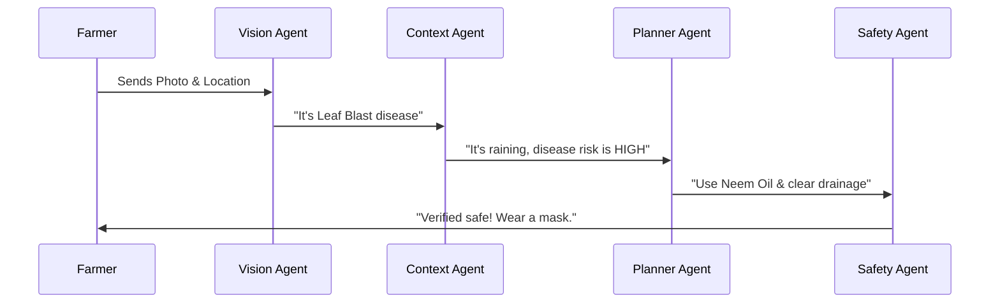

# Chapter 1: Multi-Agent Pipeline Orchestration

Welcome to the first chapter of the **Tani Pintar** (Smart Farming) tutorial! 

Imagine you are a farmer named Pak Budi. You notice strange spots on your chili plants. Instead of just guessing what's wrong, you go to a specialized agricultural clinic. In this clinic, you don't just talk to one person. You go through a series of experts:

1.  A **Photographer** who identifies the plant and the disease.
2.  A **Weather Analyst** who checks if the current rain and humidity will make the disease spread faster.
3.  A **Treatment Planner** who suggests low-cost, organic ways to fix it.
4.  A **Safety Inspector** who double-checks the advice to make sure it won't hurt you or the environment.

This "expert relay race" is what we call **Multi-Agent Pipeline Orchestration**.

## Why not just use one AI?

If you ask a single AI to do everything at once, it might get overwhelmed and give generic or "hallucinated" (fake) advice. By breaking the problem into a **Pipeline**, we ensure that each "Agent" focuses on one specific job, making the final answer much more accurate and reliable for the farmer.

---

## How the "Relay Race" Works

In Tani Pintar, the orchestration happens in a specific order. Each agent waits for the one before it to finish and uses that information to do its own job.



### The 4 Specialized Agents:
1.  **[Vision Diagnostician (Agent 1)](02_vision_diagnostician__agent_1__.md):** The "Eyes." It looks at the photo.
2.  **[Microclimate Contextualizer (Agent 2)](03_microclimate_contextualizer__agent_2__.md):** The "Environment Expert." It checks the weather.
3.  **[Organic-First Action Planner (Agent 3)](04_organic_first_action_planner__agent_3__.md):** The "Doctor." It creates a 7-day recovery plan.
4.  **[Safety & Compliance Auditor (Agent 4)](05_safety___compliance_auditor__agent_4__.md):** The "Guardian." It ensures the plan is safe for humans.

---

## Using the Pipeline

To start this process, we send a request to our server. We don't just send a photo; we send context like the location and a note from the farmer.

### Example Input
```json
{
  "imageBase64": "...", 
  "cropType": "Chili",
  "location": "Subang, West Java",
  "farmerNote": "It has been raining for 3 days."
}
```
*This data is the "baton" that gets passed through the relay race.*

---

## Under the Hood: The Orchestrator

In our `server.ts` file, the orchestrator acts as the manager. It calls each agent one by one. Here is a simplified look at how it manages the sequence:

### 1. Starting the Vision Agent
```typescript
// Agent 1: Identify what we see in the photo
const visionResult = await callVisionAgent(imageBase64, farmerNote);
```
*The manager gives the photo to the Vision expert and waits for the diagnosis.*

### 2. Passing Info to the Context Agent
```typescript
// Agent 2: Check weather based on the location and diagnosis
const weather = await fetchWeather(location);
const contextResult = await callContextAgent(visionResult, weather);
```
*The manager takes the diagnosis from Agent 1 and gives it to Agent 2 along with weather data.*

### 3. Creating the Plan
```typescript
// Agent 3: Create a step-by-step organic plan
const plannerResult = await callPlannerAgent(visionResult, contextResult);
```
*Now that we know the disease and the weather, the Doctor (Planner) makes a schedule.*

### 4. The Final Safety Audit
```typescript
// Agent 4: Final check for safety and human health
const safetyResult = await callSafetyAgent(visionResult, plannerResult);
```
*Before showing anything to the farmer, the Safety agent checks if the plan needs warnings.*

---

## Summary

**Multi-Agent Pipeline Orchestration** is the "brain" of Tani Pintar. It transforms a simple photo into a professional, safe, and localized agricultural report by:
- Breaking a big task into 4 small, expert tasks.
- Passing data sequentially like a relay race.
- Ensuring safety and accuracy at every step.

In the next chapter, we will look at the first expert in our clinic: the one who provides the eyes for our system.

[Next Chapter: Vision Diagnostician (Agent 1)](02_vision_diagnostician__agent_1__.md)

---

Generated by [AI Codebase Knowledge Builder](https://github.com/The-Pocket/Tutorial-Codebase-Knowledge)