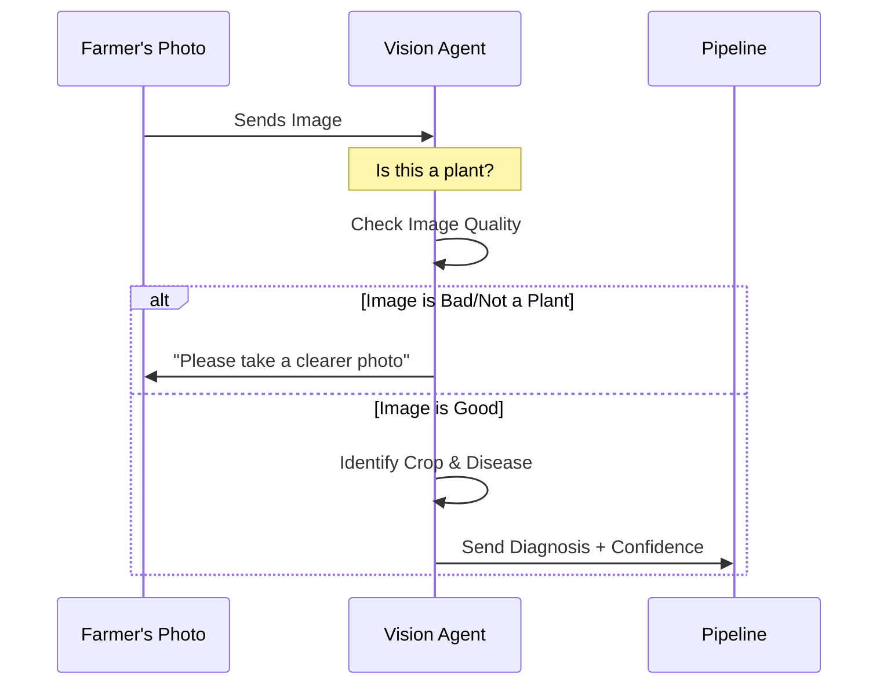

# Chapter 2: Vision Diagnostician (Agent 1)

In [Chapter 1: Multi-Agent Pipeline Orchestration](01_multi_agent_pipeline_orchestration_.md), we learned how Tani Pintar uses a "relay race" of experts to help farmers. In this chapter, we meet our first expert: the **Vision Diagnostician**.

Think of this agent as the "Digital Pathologist." Before we can suggest a cure, we need to see the patient. This agent provides the eyes for our system.

---

## Why do we need a Vision Agent?

Imagine Pak Budi takes a photo of his chili plant, but the photo is very blurry, or he accidentally uploads a picture of his tractor. If the AI tries to give farming advice on a blurry photo or a tractor, it will "hallucinate" (make things up).

The Vision Diagnostician solves this by acting as a **Quality Gatekeeper**. It ensures that:
1. The photo is actually a plant.
2. The photo is clear enough to read.
3. It identifies the specific crop and the likely disease.

---

## Key Concepts

### 1. The Quality Gatekeeper
The agent first checks if the image is `good`, `poor` (blurry), or `not_a_plant`. If it's a photo of a shoe, the agent stops the pipeline immediately to prevent wrong advice.

### 2. Differential Diagnosis
Just like a real doctor, the agent doesn't just give one answer. It provides a list of possibilities (e.g., "70% sure it's Leaf Blast, but 20% possibility of Brown Spot").

### 3. Confidence Scores
It tells us how "sure" it is. If the confidence is low (below 60%), we trigger special safety warnings in later chapters.

---

## How it works (The Logic)

When a farmer uploads a photo, the Vision Agent follows this internal "thought process":



---

## Under the Hood: The Vision Prompt

We use the Gemini AI model to act as this expert. We give it very specific instructions (called a "Prompt"). Here is a simplified version of what we tell the AI:

```typescript
// Inside src/services/geminiPipeline.ts
const visionPrompt = `
Analyze this crop image thoroughly.
1. Check 'image_quality': "good", "poor", or "not_a_plant".
2. If it is a healthy plant, say so!
3. If diseased, identify the species and the problem.
4. Provide a confidence score between 0.0 and 1.0.
`;
```
*This prompt tells the AI exactly what its "job description" is for this step.*

### Defining the Output Structure
To make sure the next agent understands the data, we force the AI to answer in a specific format (JSON).

```typescript
// We define a schema so the AI always uses the same labels
responseSchema: {
  type: Type.OBJECT,
  properties: {
    crop: { type: Type.STRING },
    isHealthy: { type: Type.BOOLEAN },
    primaryDiagnosis: { type: Type.STRING },
    overallConfidence: { type: Type.NUMBER }
  }
}
```
*By defining a "Schema," we ensure the AI doesn't get creative with its wording, making the code more stable.*

---

## Handling Bad Photos

If the agent detects a "non-plant" or a "blurry" photo, it returns a specific result that stops the other agents from working.

```typescript
// If quality is bad, we skip the other experts
if (visionResult.image_quality === 'not_a_plant') {
  return {
    success: true,
    vision: visionResult,
    planner: { strategyOverview: "Please upload a plant photo." }
    // Other agents are skipped!
  };
}
```
*This "early exit" saves time and prevents the system from giving "hallucinated" advice on non-farming images.*

---

## Summary

The **Vision Diagnostician** is the foundation of the Tani Pintar pipeline. It:
- **Sees** the crop and the problem.
- **Filters** out bad or irrelevant photos.
- **Measures** its own certainty with a confidence score.

Now that we know *what* the disease is, we need to understand the environment it's growing in.

[Next Chapter: Microclimate Contextualizer (Agent 2)](03_microclimate_contextualizer__agent_2__.md)

---

Generated by [AI Codebase Knowledge Builder](https://github.com/The-Pocket/Tutorial-Codebase-Knowledge)