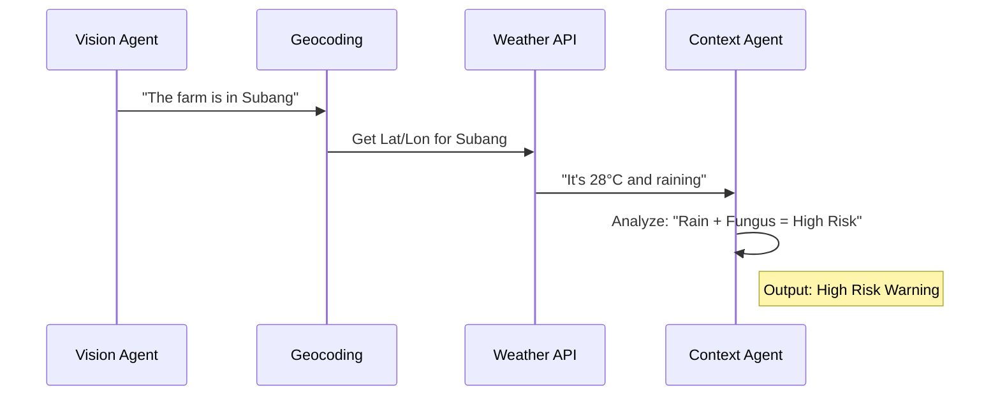

# Chapter 3: Microclimate Contextualizer (Agent 2)

In [Chapter 2: Vision Diagnostician (Agent 1)](02_vision_diagnostician__agent_1__.md), we gave our AI "eyes" to see the plant disease. But knowing *what* the disease is only tells half the story. 

Imagine Pak Budi finds a fungus on his chili. If the weather is dry and sunny, that fungus might grow slowly. But if it has been raining for three days and the humidity is 95%, that fungus will spread like a forest fire. 

This is where the **Microclimate Contextualizer** comes in.

---

## Why do we need a Context Agent?

A doctor doesn't just look at your symptoms; they ask if you've been traveling or if it's flu season. Similarly, our AI needs to know the environment. This agent acts like a **Local Scout** who knows the "vibe" of the farm.

The Microclimate Contextualizer solves two main problems:
1.  **Raw Data is Boring:** A farmer doesn't need to be told "Humidity is 88%." They need to know "88% humidity makes your leaf blast spread 2x faster."
2.  **Location Matters:** Diseases behave differently in the cool mountains of Magelang versus the humid coast of Jakarta.

---

## Key Concepts

### 1. Grounding
"Grounding" means connecting the AI's "brain" to real-world facts. By using live weather data, we prevent the AI from giving generic advice and make it specific to Pak Budi's actual field.

### 2. The Open-Meteo API
Instead of buying expensive sensors for every farm, we use **Open-Meteo**, a free service that provides weather data for any GPS coordinate on Earth.

### 3. Disease Risk Level
The agent translates raw numbers into a simple scale: **Low, Moderate, High, or Severe**. This helps the farmer prioritize their work.

---

## How it works (The Logic)

The process happens in a quick three-step sequence:



---

## Under the Hood: The Implementation

Let's look at how we turn a location name into a weather-aware diagnosis.

### 1. Finding the Farm (Geocoding)
First, we turn a typed name like "Subang" into numbers (Latitude and Longitude).

```typescript
// Inside server.ts
async function geocodeLocation(query: string) {
  const url = `https://geocoding-api.open-meteo.com/v1/search?name=${query}`;
  const res = await fetch(url);
  const data = await res.json();
  // We take the first result's coordinates
  return { lat: data.results[0].latitude, lon: data.results[0].longitude };
}
```
*This code translates a human word into a digital "map pin" so the weather service knows exactly where to look.*

### 2. Checking the Weather
Once we have the coordinates, we ask for the "Microclimate" data (humidity, rain, and temperature).

```typescript
// Inside server.ts
async function fetchWeather(lat: number, lon: number) {
  const url = `https://api.open-meteo.com/v1/forecast?latitude=${lat}&longitude=${lon}&current=temperature_2m,relative_humidity_2m,precipitation`;
  const res = await fetch(url);
  return await res.json(); // Returns the current weather metrics
}
```
*We specifically ask for `relative_humidity_2m` because moisture is the #1 fuel for plant diseases.*

### 3. The AI Analysis (The Prompt)
Finally, we give the diagnosis from Agent 1 and the weather from Step 2 to the AI. Here is the simplified "instruction" (Prompt) we give it:

```typescript
// Inside src/services/geminiPipeline.ts
const contextPrompt = `
You are the Context Agent.
Diagnosis: ${visionResult.primaryDiagnosis}
Weather: ${weatherData.temperature}°C, ${weatherData.relativeHumidity}% humidity.
Task: Explain how this weather affects this specific disease. 
Is the risk high or low?
`;
```
*This turns raw numbers into an expert opinion, like: "Because humidity is over 80%, the spores will germinate faster."*

---

## Example Output

When the agent finishes, it produces a report that looks like this:

**Input:**
- **Disease:** Rice Leaf Blast
- **Weather:** 92% Humidity, Heavy Rain

**Agent 2 Output:**
- **Risk Level:** `HIGH`
- **Explanation:** "Heavy rain is splashing the fungus spores from one leaf to another, while high humidity allows them to survive longer."
- **Advisory:** "Clear your drainage immediately to reduce standing water."

---

## Summary

The **Microclimate Contextualizer** ensures that Tani Pintar isn't just a "photo app"—it's a real-time farming assistant. It:
- **Locates** the farm using Geocoding.
- **Fetches** live data from the Open-Meteo API.
- **Translates** weather metrics into an actionable "Risk Level."

Now that we know *what* the disease is and *how fast* it’s spreading, we need a plan to stop it.

[Next Chapter: Organic-First Action Planner (Agent 3)](04_organic_first_action_planner__agent_3__.md)

---

Generated by [AI Codebase Knowledge Builder](https://github.com/The-Pocket/Tutorial-Codebase-Knowledge)