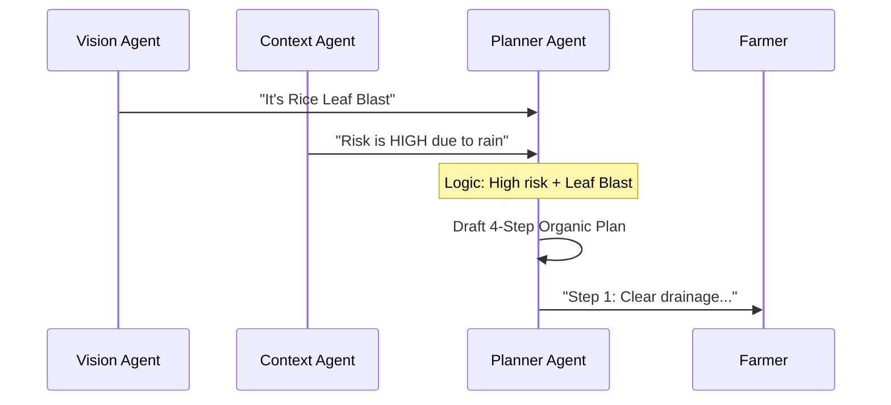

# Chapter 4: Organic-First Action Planner (Agent 3)

In [Chapter 3: Microclimate Contextualizer (Agent 2)](03_microclimate_contextualizer__agent_2__.md), we learned how to assess the risk of a disease based on the weather. Now that we know what the problem is and how fast it might spread, it’s time to act!

Imagine Pak Budi is worried about his costs. If he goes to a store, they might sell him expensive chemicals right away. But Tani Pintar’s **Action Planner** acts like a frugal, eco-conscious consultant. It looks for "Organic-First" solutions that use materials Pak Budi might already have at home.

---

## Why "Organic-First"?

Smallholder farmers often have limited cash. Buying synthetic pesticides is not only expensive but can also hurt the soil and the farmer's health if used incorrectly. 

The Action Planner follows a philosophy called **Integrated Pest Management (IPM)**. This means:
1.  **Cultural (Free):** Cleaning the field or pruning sick leaves.
2.  **Organic (Low Cost):** Making sprays from garlic, neem leaves, or wood ash.
3.  **Biological:** Using "good" fungi to fight "bad" fungi.
4.  **Chemical (Last Resort):** Only suggested if everything else fails.

---

## Key Concepts

### 1. The 4-Step Recovery Timeline
Instead of a long list of instructions, the agent creates a 4-step schedule. This helps the farmer know exactly what to do on Day 1 versus Day 7.

### 2. Locally Accessible Materials
The agent is trained to suggest things found in a typical Indonesian village, like *daun mimba* (neem), *bawang putih* (garlic), or *abu dapur* (wood ash).

### 3. Strategy Overview
Before the steps, the agent explains *why* it chose this plan. This builds trust with the farmer.

---

## How it works (The Logic)

The Planner Agent takes the diagnosis from Agent 1 and the weather risk from Agent 2 to build the plan.



---

## Under the Hood: The Instructions

In `src/services/geminiPipeline.ts`, we give the AI a very specific "personality." We tell it to be a "Low-cost IPM specialist."

### 1. Setting the "Organic" Rule
We tell the AI that it MUST prefer low-cost options. Here is a simplified version of the prompt:

```typescript
// Inside geminiPipeline.ts
const plannerPrompt = `
Smallholder farmers have limited cash. 
You MUST PREFER LOW-COST AND ORGANIC OPTIONS FIRST.
Diagnosis: ${visionResult.primaryDiagnosis}
Weather Risk: ${contextResult.diseaseRiskLevel}
Task: Create a 4-step timeline. 
Step 1 should be Cultural (Free). Step 2 Organic.
`;
```
*This instruction ensures the AI doesn't just suggest the most expensive chemical on the market.*

### 2. Defining the "Step" Structure
To make the app look nice, we ask the AI to categorize every action.

```typescript
// Each step must follow this structure
{
  "stepNumber": 1,
  "timeFrame": "Immediate (Day 1)",
  "category": "cultural", // or "organic", "chemical"
  "estimatedCost": "free",
  "materialsNeeded": ["Pruning shears", "Trash bag"]
}
```
*By categorizing steps, we can show colorful "Free" or "Organic" badges in the app.*

---

## Example Output

If Pak Budi’s chili has a fungal spot during a rainy week, the Planner Agent might output:

*   **Strategy:** "Since it's raining, we must stop the fungus from splashing to other leaves. We will use a homemade garlic spray as a natural fungicide."
*   **Step 1 (Free):** Remove all leaves that have spots and bury them far away.
*   **Step 2 (Low Cost):** Mix 2 bulbs of crushed garlic with water and spray the plants.
*   **Step 3 (Low Cost):** Apply wood ash around the base of the plant to strengthen it.
*   **Step 4 (Free):** Widen the distance between plants for better airflow.

---

## The UI: Showing the Plan

In `src/components/ActionPlanTimeline.tsx`, the code takes this data and turns it into a vertical timeline. 

```typescript
// We use colors to help farmers identify the type of action
function getCategoryBadge(category) {
  if (category === 'organic') return 'bg-emerald-100 text-emerald-800';
  if (category === 'chemical') return 'bg-red-100 text-red-800';
  return 'bg-stone-100';
}
```
*Simple color-coding helps the farmer immediately see if the plan is budget-friendly.*

---

## Summary

The **Organic-First Action Planner** is the "heart" of the advice. It:
- **Prioritizes** the farmer's wallet and the environment.
- **Translates** complex science into 4 simple steps.
- **Focuses** on locally available materials like garlic and ash.

However, even organic advice needs a safety check. What if the farmer is allergic to a material, or what if the AI is wrong? We need a final "Guardian" to check the plan.

[Next Chapter: Safety & Compliance Auditor (Agent 4)](05_safety___compliance_auditor__agent_4__.md)

---

Generated by [AI Codebase Knowledge Builder](https://github.com/The-Pocket/Tutorial-Codebase-Knowledge)