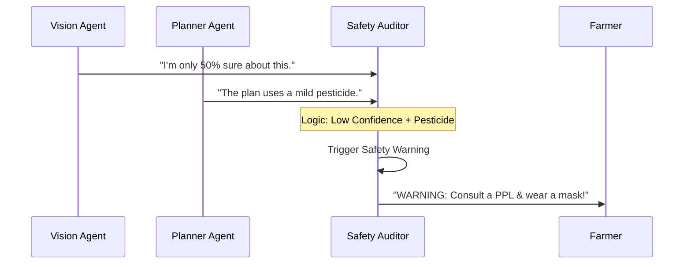

# Chapter 5: Safety & Compliance Auditor (Agent 4)

In [Chapter 4: Organic-First Action Planner (Agent 3)](04_organic_first_action_planner__agent_3__.md), we learned how the AI creates a budget-friendly, 7-day recovery plan for the farmer. But there is one final, critical question: **Is this advice safe to follow?**

Imagine Pak Budi is about to spray a homemade garlic mixture on his plants. The AI is only 55% sure about the disease, and Pak Budi has a small pond nearby where he keeps fish. If the AI is wrong, or if the mixture leaks into the pond, it could be a disaster. 

This is where the **Safety & Compliance Auditor** (Agent 4) steps in.

---

## The "Guardian" of the Farm

Think of Agent 4 as a **Strict Laboratory Supervisor**. Even if the Doctor (Planner) writes a prescription, the Safety Auditor double-checks everything before the farmer sees it. It acts as the final "gatekeeper" to ensure the AI never gives high-risk advice without a warning.

The Safety Auditor solves three main problems:
1.  **AI Uncertainty:** If the Vision Agent is confused, the Safety Agent forces the farmer to talk to a human expert.
2.  **Chemical Hazards:** If chemicals are involved, it enforces strict protection rules.
3.  **Environmental Safety:** It protects "good" insects like bees and prevents water pollution.

---

## Key Concepts

### 1. The PPL Mandate
In Indonesia, a **PPL** (*Penyuluh Pertanian Lapangan*) is an official Agricultural Extension Officer. Agent 4 is programmed to prioritize human expertise. If there is any doubt, it tells the farmer: *"Stop. Talk to your local PPL first."*

### 2. Confidence Thresholds
The agent looks at the "Confidence Score" from [Chapter 2: Vision Diagnostician (Agent 1)](02_vision_diagnostician__agent_1__.md). If the score is below **60%**, the Safety Agent automatically flags the report as "High Risk."

### 3. PPE Checklist
**PPE** stands for Personal Protective Equipment. The agent provides a mandatory checklist (Masks, Gloves, Boots) to ensure the farmer's physical health.

---

## How it works (The Logic)

The Safety Agent doesn't look at the photo. Instead, it looks at the *data* produced by all the previous agents to decide if the plan is safe.



---

## Under the Hood: The Safety Audit

In `src/services/geminiPipeline.ts`, we define the rules for when a warning is required.

### 1. Deciding to Trigger a Warning
The code checks three main "red flags" before allowing the report to be "Approved."

```typescript
// A warning is required if:
const topConfidence = visionResult.overallConfidence;
const confidenceTooLow = topConfidence < 0.6; // Red Flag 1
const planContainsChemicals = plannerResult.containsChemicals; // Red Flag 2

const mandatoryWarning = confidenceTooLow || planContainsChemicals;
```
*If any of these conditions are true, the system will show a big orange warning box to the farmer.*

### 2. The PPE Checklist
Even for organic sprays, safety is important. The agent generates a list of gear the farmer needs.

```typescript
// Inside the Safety Agent Prompt
const safetyPrompt = `
Provide concrete required PPE for the farmer:
- Mask for nose and mouth
- Rubber gloves
- Field boots
- Long-sleeved clothing
`;
```
*By providing a list, we make it easy for the farmer to stay safe while working.*

### 3. Prohibiting Dosages
One of the most important safety rules is that **AI should not give chemical dosages.** 

```typescript
// This is a strict rule in the Safety Agent instruction
const criticalNotice = `
NEVER give specific chemical dosages. 
Always tell the farmer to follow the PPL's instructions 
or the label on the bottle.
`;
```
*This prevents "hallucinated" dosages that could accidentally kill the plants or harm the soil.*

---

## The UI: The Safety Alert Box

In `src/components/SafetyAlert.tsx`, we use colors to tell the farmer if the plan is "Approved" or "Needs Caution."

- **Green Card:** If the plan is 100% organic and the AI is very confident.
- **Orange Card:** If the AI is unsure or chemicals are suggested.

### Example Warning Output:
> **⚠️ Safety Warning Required**
> - **Reason:** AI Confidence is low (55%).
> - **Mandatory Action:** Please consult your local PPL at the BPP center.
> - **PPE Needed:** Rubber gloves and a face mask.
> - **Environmental Note:** Do not spray near the fish pond.

---

## Summary

The **Safety & Compliance Auditor** is the "conscience" of Tani Pintar. It:
- **Protects** the farmer from taking advice that might be wrong.
- **Enforces** the use of protective gear (PPE).
- **Respects** human authority by directing farmers to official PPL officers.
- **Guards** the environment by suggesting buffer zones for water and bees.

With all four agents finished, our pipeline is complete! However, there is one last step: making sure this information is accessible to farmers in their own language.

[Next Chapter: Bilingual Localization (i18n)](06_bilingual_localization__i18n__.md)

---

Generated by [AI Codebase Knowledge Builder](https://github.com/The-Pocket/Tutorial-Codebase-Knowledge)