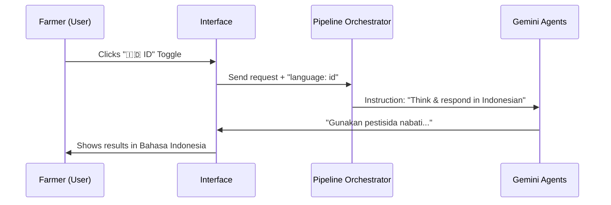

# Chapter 6: Bilingual Localization (i18n)

In [Chapter 5: Safety & Compliance Auditor (Agent 4)](05_safety___compliance_auditor__agent_4__.md), we learned how to keep the farmer safe by adding warnings and PPL (Agricultural Extension Officer) advice. But there is a final hurdle: **What if the farmer doesn't speak English?**

Agricultural science is full of complex English terms. If Tani Pintar only speaks English, it can't help a local farmer in West Java. But if it only speaks Indonesian, it can't be used by global researchers. This is where **Bilingual Localization (i18n)** comes in.

---

## What is i18n?

**i18n** is a developer's shorthand for **Internationalization** (there are 18 letters between the 'i' and the 'n'). 

In Tani Pintar, localization isn't just about changing the text on a button from "Diagnose" to "Diagnosis." It is about changing the **entire thought process** of the AI. 

When Pak Budi selects **Bahasa Indonesia**, the AI doesn't just translate its final answer; it changes its vocabulary to use terms Pak Budi knows, like:
- **PPL** instead of "Extension Officer."
- **HDB** (Hawar Daun Bakteri) instead of "Bacterial Leaf Blight."

---

## Key Concepts

### 1. The Translation Map
Instead of "hard-coding" words (writing them directly in the UI), we use a central map. The app looks at this map and says: *"If the user chose ID, use this word; if they chose EN, use that one."*

### 2. Prompt Injection (The Good Kind!)
When we call our agents (like the [Vision Diagnostician](02_vision_diagnostician__agent_1__.md)), we "inject" the language choice into the instruction. We tell the AI: *"You are an Indonesian agronomist. Use local terms."*

### 3. Cultural Relevance
Localization means the advice fits the culture. In Indonesia, suggesting a specific village-level coop (KUD) or a PPL officer makes more sense than suggesting a generic "crop consultant."

---

## How it works (The Logic)

The language choice flows from the user's screen all the way into the AI's "brain."



---

## Under the Hood: The Implementation

### 1. The Language Map
In `src/i18n/translations.ts`, we store all our words in two big buckets: `id` and `en`.

```typescript
// A simplified version of our translation map
export const translations = {
  id: {
    diagnoseButton: 'Jalankan Diagnosis',
    safetyWarning: 'Peringatan Penting PPL'
  },
  en: {
    diagnoseButton: 'Run Diagnosis',
    safetyWarning: 'Important Safety Warning'
  }
};
```
*This map ensures that we never have to hunt through 10 different files just to change a single word.*

### 2. The Language Switcher
In `src/components/Header.tsx`, we have a simple button that tells the whole app which bucket to use.

```typescript
// Swapping the "state" of the language
const t = translations[language]; 

return (
  <button onClick={() => onLanguageChange('id')}>
    🇮🇩 ID
  </button>
);
```
*When the button is clicked, the `t` variable instantly switches all the text in the app.*

### 3. Talking to the AI in its own Language
This is the most important part. In `src/services/geminiPipeline.ts`, we pass the language to the AI agents.

```typescript
// Inside the AI Prompt
const visionPrompt = `
...
Requested output language: ${language === 'id' ? 'Bahasa Indonesia' : 'English'}.
Use local agricultural terminology if applicable.
`;
```
*By telling the AI which language to use BEFORE it starts thinking, we get much more natural and helpful advice.*

---

## Why this is "Smart" Localization

Standard apps use a "translator" to change the text *after* it's written. Tani Pintar is different. Because we pass the language into the [Multi-Agent Pipeline](01_multi_agent_pipeline_orchestration_.md), the AI acts as a **Native Expert**.

**Example Output (Language: ID):**
> "Berdasarkan diagnosa, padi Anda terkena **HDB**. Segera temui petugas **PPL** di BPP terdekat untuk bantuan lebih lanjut."

**Example Output (Language: EN):**
> "Based on the diagnosis, your rice has **Bacterial Leaf Blight**. Please consult your **Agricultural Extension Officer** for further assistance."

---

## Summary

**Bilingual Localization** makes Tani Pintar accessible and trustworthy. We learned:
- How to use a **Translation Map** for UI text.
- How to **Instruct the AI** to think in a specific language.
- Why **Local Terminology** (like PPL) builds trust with farmers.

Our experts have analyzed the photo, checked the weather, made a plan, verified safety, and translated everything. But how do we know what the AI was "thinking" during this whole process? 

In the final chapter, we will look at the "hidden log" of the AI's brain.

[Next Chapter: Agent Execution Trace](07_agent_execution_trace_.md)

---

Generated by [AI Codebase Knowledge Builder](https://github.com/The-Pocket/Tutorial-Codebase-Knowledge)