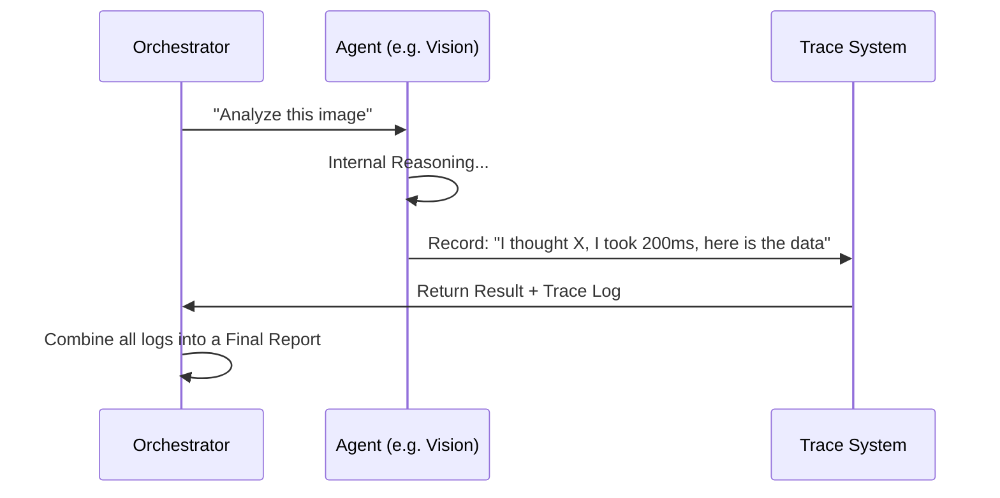

# Chapter 7: Agent Execution Trace

In [Chapter 6: Bilingual Localization (i18n)](06_bilingual_localization__i18n__.md), we made our AI speak the language of the farmer. But even if the AI speaks your language, you might still wonder: *"How did it reach this conclusion? Can I trust it?"*

This is where the **Agent Execution Trace** comes in.

---

## The "Flight Recorder" for AI

Imagine an airplane. Inside, there is a "black box" or flight recorder. It tracks every turn the pilot makes and every button they press. If something goes wrong—or even if everything goes right—we can look at the recorder to see exactly what happened.

In **Tani Pintar**, the Agent Execution Trace is our black box. It records:
1.  **Thinking:** What the AI was "musing" about before it gave an answer.
2.  **Tools:** Which APIs it called (like the weather service).
3.  **Speed:** Exactly how many milliseconds each agent took.
4.  **Raw Data:** The technical "receipt" of the work.

---

## Why do we need a Trace?

Without a trace, AI feels like "magic." But magic is hard to fix when it breaks. 

1.  **For Developers:** If the [Safety Auditor](05_safety___compliance_auditor__agent_4__.md) fails, we can see if it was because the AI was confused or because the server was slow.
2.  **For Advanced Users:** An agricultural expert can verify if the [Vision Diagnostician](02_vision_diagnostician__agent_1__.md) actually looked at the spots on the leaves or just guessed based on the crop type.
3.  **Trust:** By showing the "Chain of Thought," we prove to the farmer that we aren't just flipping a coin.

---

## Key Concepts

### 1. The Thought Process (Chain of Thought)
Before an agent gives a final JSON answer, we ask it to "think out loud." This is stored in the `thoughtProcess` field. It’s like a student showing their work on a math test.

### 2. Duration Metadata
We track `durationMs`. If the [Context Agent](03_microclimate_contextualizer__agent_2__.md) takes 5 seconds to get weather data, we know the internet connection might be slow.

### 3. Raw Output
This is the "technical receipt." It contains the exact data the AI produced before it was turned into pretty buttons and text in our app.

---

## How it works (The Logic)

Each time an agent in the [Multi-Agent Pipeline](01_multi_agent_pipeline_orchestration_.md) runs, it writes a page in our "diary."



---

## Under the Hood: The Trace Object

In `src/types/index.ts`, we define exactly what a "Trace Step" looks like. It is a simple record for one agent.

### 1. Defining the Step
```typescript
// A simplified look at the Trace Step
export interface AgentTraceStep {
  agentId: string;      // e.g., "vision"
  status: string;       // "completed" or "failed"
  durationMs: number;   // How fast was it?
  thoughtProcess: string; // The "internal monologue"
  modelUsed: string;    // e.g., "gemini-1.5-flash"
}
```
*This structure ensures every agent records the same type of information.*

### 2. Tracking the Time
In our server logic, we mark the time before and after the agent works.

```typescript
// Measuring the speed of an agent
const start = Date.now();
const result = await callAgent(); 
const end = Date.now();

const duration = end - start; // This is our durationMs
```
*Simple math tells us exactly how long the "Expert" took to think.*

### 3. Collecting the "Thoughts"
We tell the AI to include its reasoning in its response. We then extract that and put it into the trace.

```typescript
// Extracting the internal reasoning
const traceEntry = {
  agentId: 'planner',
  thoughtProcess: result.reasoning, // The AI's explanation
  rawOutput: result, // The full data
  durationMs: duration
};
```
*By saving the `reasoning` separately, we can show the "Why" behind the "What."*

---

## Viewing the Trace: The Trace Modal

In the Tani Pintar app, there is a section called **"Agent Execution Trace"** (built in `AgentTraceModal.tsx`). 

When you open it, you see a technical timeline:
- **Vision Agent:** "I saw yellow spots and high confidence of fungus." (240ms)
- **Context Agent:** "I fetched weather for Subang; humidity is high." (110ms)
- **Planner Agent:** "Since it's rainy, I'll suggest a garlic spray." (450ms)

### Example Raw Output
If you click "Copy JSON" in the app, you see the "Technical Receipt":
```json
{
  "agentId": "vision",
  "modelUsed": "gemini-1.5-flash",
  "status": "completed",
  "durationMs": 850,
  "rawOutput": {
    "crop": "Chili",
    "overallConfidence": 0.85
  }
}
```
*This is the raw data that developers use to debug the system.*

---

## Summary

The **Agent Execution Trace** is the final piece of the Tani Pintar puzzle. It provides:
- **Transparency:** No more "Black Box" AI.
- **Accountability:** We know which agent said what.
- **Debugging:** We can see exactly where a delay or error happened.

You have now completed the Tani Pintar tutorial! You've learned how a photo of a sick plant travels through a [Multi-Agent Pipeline](01_multi_agent_pipeline_orchestration_.md), gets [Context](03_microclimate_contextualizer__agent_2__.md), receives a [Plan](04_organic_first_action_planner__agent_3__.md), passes a [Safety Check](05_safety___compliance_auditor__agent_4__.md), gets [Translated](06_bilingual_localization__i18n__.md), and finally leaves a [Trace](07_agent_execution_trace_.md) for us to audit.

Happy Farming and Happy Coding!

---

Generated by [AI Codebase Knowledge Builder](https://github.com/The-Pocket/Tutorial-Codebase-Knowledge)