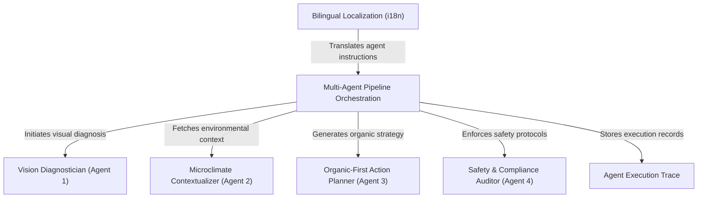

# Tutorial: Tani Pintar

**Tani Pintar** is an AI-powered agricultural advisor that uses a specialized **multi-agent pipeline** to help farmers diagnose and treat crop diseases. Instead of a single AI guess, the system coordinates four distinct agents—*Vision, Context, Planner, and Safety*—to provide high-accuracy, weather-aware, and eco-friendly recovery plans. It prioritizes *low-cost organic solutions* and ensures farmer safety through strict compliance checks and local agricultural officer (PPL) verification.

**Source Repository:** [https://github.com/Logika-Digital/tani-pintar](https://github.com/Logika-Digital/tani-pintar)

## Chapters

1. [Multi-Agent Pipeline Orchestration
](01_multi_agent_pipeline_orchestration_.md)
2. [Vision Diagnostician (Agent 1)
](02_vision_diagnostician__agent_1__.md)
3. [Microclimate Contextualizer (Agent 2)
](03_microclimate_contextualizer__agent_2__.md)
4. [Organic-First Action Planner (Agent 3)
](04_organic_first_action_planner__agent_3__.md)
5. [Safety & Compliance Auditor (Agent 4)
](05_safety___compliance_auditor__agent_4__.md)
6. [Bilingual Localization (i18n)
](06_bilingual_localization__i18n__.md)
7. [Agent Execution Trace
](07_agent_execution_trace_.md)

---

Generated by [AI Codebase Knowledge Builder](https://github.com/The-Pocket/Tutorial-Codebase-Knowledge)